# اصول معماری و استانداردهای حسابداری مالی (Accounting Architecture Principles)

این سند اصول بنیادین، قواعد تغییرناپذیری، استانداردهای دقت محاسباتی و الزامات حسابرسی سیستم مالی و حسابداری ERP را تعیین می‌کند. رعایت این اصول در تمامی بخش‌های سیستم که به نحوی با تراکنش‌های مالی سر و کار دارند (مانند خزانه‌داری، انبار، خرید، فروش و حقوق و دستمزد) الزامی است.

> [!IMPORTANT]
> مطابق نیازمندی‌های این مرحله، هیچ منطق محاسباتی یا کدی برای حسابداری پیاده‌سازی نمی‌شود؛ این سند صرفاً به عنوان **میثاق و قانون حاکم بر طراحی** ماژول‌های سیستم عمل می‌کند.

---

## ۱. اصول هشت‌گانه معماری مالی

```mermaid
graph TD
    P1["۱. حسابداری دوبل\n(Double Entry Accounting)"]
    P2["۲. تغییرناپذیری اسناد قطعی\n(Immutable Posted Vouchers)"]
    P3["۳. مدیریت دوره‌های مالی\n(Financial Periods)"]
    P4["۴. دقت اعشاری بالا\n(Strict Decimal Precision)"]
    P5["۵. حسابرسی‌پذیری و اصالت سند\n(Auditability & Provenance)"]
    P6["۶. اصلاح صرفاً با سند معکوس\n(Reversal & Storno Documents)"]
    P7["۷. عملیات یکتا و بدون تکرار\n(Idempotent Financial Operations)"]
    P8["۸. یکپارچگی اتمیک تراکنش\n(Transactional Consistency)"]
```

---

### اصل ۱: حسابداری دوبل (Double Entry Accounting)
- هر سند حسابداری شامل حداقل دو ردیف است (یک ردیف بدهکار و یک ردیف بستانکار).
- در زمان تایید یا ثبت دائم یک سند، **مجموع مبالغ بدهکار باید دقیقاً برابر با مجموع مبالغ بستانکار باشد**:
  $$\sum \text{Debit} = \sum \text{Credit}$$
- هیچ سندی با اختلاف حتی ۰.۰۰۰۱ واحد پولی حق تبدیل به وضعیت تاییدشده یا دائم را ندارد (عدم تراز = خطای مسدودکننده).

---

### اصل ۲: تغییرناپذیری اسناد ثبت‌شده (Immutable Posted Vouchers)
- چرخه حیات اسناد حسابداری دارای حالت‌های مشخص است:
  `Draft (پیش‌نویس)` $\rightarrow$ `Reviewed (بررسی‌شده)` $\rightarrow$ `Approved (تاییدشده)` $\rightarrow$ `Posted (ثبت قطعی / دائم)`.
- **قانون تغییرناپذیری:** به محض رسیدن سند به وضعیت `Posted`، آن سند و تمامی سطرهای آن **برای همیشه غیرقابل‌ویرایش و غیرقابل‌حذف** هستند.
- متدهای `UPDATE` و `DELETE` روی اسناد دائم در سطح لایه دامنه، سرویس‌های وب و به کمک تریگرهای پایگاه داده مسدود خواهند بود.

---

### اصل ۳: مدیریت دوره‌ها و سال‌های مالی (Financial Period Management)
- اسناد مالی متعلق به یک سال مالی (`FiscalYear`) و یک دوره مالی ماهانه/فصلی (`FinancialPeriod`) مشخص در یک شرکت هستند.
- هر دوره مالی دارای وضعیت‌های مشخص است: `Open (باز)`، `Locked (قفل موقت)`، `Closed (بسته قطعی)`.
- **مسدودسازی تاریخی:** ثبت هرگونه سند جدید، اصلاح سند قبلی، یا ارجاع تراکنش از سایر ماژول‌ها در دوره‌ای که در وضعیت `Closed` یا `Locked` قرار دارد، غیرممکن است.
- بستن حساب‌ها و انتقال مانده‌ها به سال بعد منحصراً از طریق اسناد رسمی اختتامیه و افتتاحیه صورت می‌گیرد.

---

### اصل ۴: دقت ارقام اعشاری و سیاست‌های گردکردن (Decimal Precision)
- مبالغ پولی، مانده حساب‌ها و گردش‌ها منحصراً با نوع داده `decimal` در سی‌شارپ و `numeric(28, 4)` در پستگرس نگهداری می‌شوند.
- در محاسبات تخفیفات درصدی، مالیات بر ارزش افزوده و بهای تمام‌شده، از روش استاندارد **گردکردن بانکی (Banker's Rounding / MidpointRounding.ToEven)** استفاده می‌شود تا از خطای انباشتگی ناشی از سوگیری گردکردن جلوگیری شود.
- مقادیر ریالی در گزارش‌های رسمی ممکن است بدون اعشار نمایش داده شوند، اما در پایگاه داده جهت دقت تبدیل ارزها و بهای واحد کالاها دقت ۴ رقم اعشار همواره حفظ می‌گردد.

---

### اصل ۵: حسابرسی‌پذیری و اصالت سند مبدأ (Auditability & Provenance)
- هیچ سند حسابداری خودکار (Auto-generated) در خلاء صادر نمی‌شود.
- هر سند باید به سند مبدأ خود در ماژول مربوطه ارجاع دهد:
  - `SourceDocumentType`: نام سند مبدأ (مانند `SalesInvoice`, `GoodsReceipt`, `PaymentVoucher`).
  - `SourceDocumentId`: شناسه یکتای سند مبدأ در ماژول صادرکننده.
- ارتباط بین سند حسابداری و سند بازرگانی همواره دوسویه و قابل ردیابی در ممیزی‌های مالیاتی و حسابرسی است.

---

### اصل ۶: اصلاح اسناد منحصراً با اسناد معکوس و اصلاحی (Reversal & Adjustment)
- چنانچه پس از قطعی شدن یک سند، اشتباهی در مبالغ یا کدینگ کشف شود:
  1. کاربر مجاز به ویرایش سند ثبت‌شده نیست.
  2. سیستم یک **سند معکوس (Reverse Voucher / Storno)** صادر می‌کند که ارقام بدهکار و بستانکار سند قبلی را بی‌اثر می‌نماید.
  3. سپس سند صحیح جدید صادر شده و هر دو سند به سند اولیه پیوند می‌خورند.
- بدین ترتیب تاریخچه کامل تصمیمات و تغییرات مالی در دفتر روزنامه شفاف باقی می‌ماند.

---

### اصل ۷: عملیات مالی ایدمپوتنت (Idempotent Financial Operations)
- برای جلوگیری از صدور اسناد تکراری در شرایط قطعی شبکه یا فشردن مکرر دکمه ثبت توسط کاربر:
  - هر تراکنش مالی موظف به ارسال یک کلید یکتایی (`Idempotency-Key` در هدر یا در قالب فیلد در بدنه درخواست) است.
  - سیستم پیش از آغاز پردازش سند، بررسی می‌کند که آیا سندی با این کلید قبلاً پردازش شده است یا خیر.
  - در صورت تکرار، بدون صدور سند جدید، همان نتیجه قبلی بازگردانده می‌شود.

---

### اصل ۸: یکپارچگی تراکنشی اتمیک (Transactional Consistency)
- تمام مراحل ثبت یک سند مالی (بررسی دوره مالی، ثبت هدر سند، ثبت کلیه سطرهای بدهکار و بستانکار، به‌روزرسانی مانده حساب‌ها، و ثبت لاگ حسابرسی) باید در قالب یک **تراکنش اتمیک واحد (ACID Transaction)** در پایگاه داده انجام شود.
- در صورت بروز هرگونه خطا در هر یک از سطرها، تمام تراکنش به صورت کامل بازگردانی (Rollback) می‌شود تا هیچ‌گاه سند ناقص یا ترازنشده در سیستم باقی نماند.
