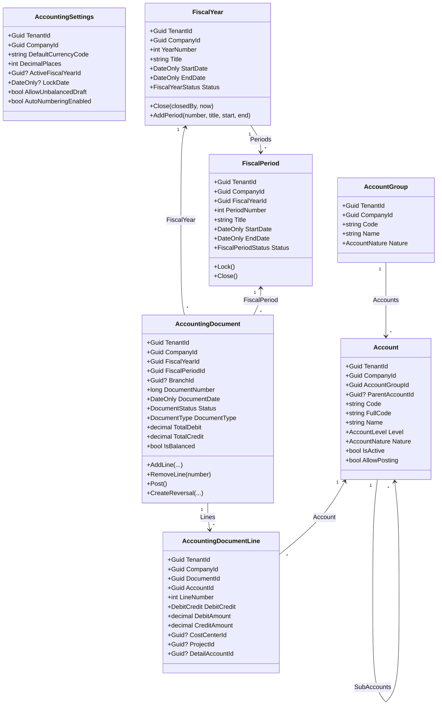

# مستند پایه دامنه و هسته مالی حسابداری (Accounting Domain Foundation)

این سند معماری مدل‌های دامنه، مفاهیم حسابداری دوبل، شیءارزش‌ها (Value Objects)، موجودیت‌ها، رویدادها و نگاشت‌های پایگاه‌داده ماژول حسابداری (`ERP.Modules.Accounting`) را تشریح می‌کند.

---

## ۱. اصول و قواعد حاکم بر هسته حسابداری (Core Financial Invariants)

1. **حسابداری دوبل (Double Entry):**
   - هر سند شامل حداقل دو سطر است.
   - شرط لازم جهت قطعی‌سازی سند: $\sum \text{Debit} == \sum \text{Credit}$ با دقت ۴ رقم اعشار (`numeric(28, 4)`).
   - سند بدون تراز هرگز به وضعیت `Posted` نخواهد رسید.

2. **تغییرناپذیری قطعی (Immutability of Posted Vouchers):**
   - پس از رسیدن وضعیت سند به `Posted`، هرگونه تغییر، حذف یا درج سطر مسدود است و استثنای `ImmutableDocumentException` پرتاب می‌شود.
   - اصلاح اشتباهات حسابداری صرفاً از طریق صدور **سند معکوس (Storno / Reversal)** با جابجایی ستون‌های بدهکار و بستانکار صورت می‌پذیرد.

3. **کنترل و ایزولاسیون دوره‌های مالی:**
   - اسناد به یک سال مالی (`FiscalYear`) و دوره مالی (`FiscalPeriod`) تخصیص می‌یابند.
   - دوره‌های در وضعیت `Locked` یا `Closed` امکان پذیرش هیچ‌گونه سند جدید یا تعدیلی را ندارند (`FiscalPeriodClosedException`).

4. **تفکیک کامل چندمستاجره و چندشرکتی:**
   - کلیه موجودیت‌ها دارای `TenantId` و `CompanyId` هستند.
   - شناسه `BranchId` صرفاً در سطح سند یا سطرها به عنوان بعد عملیاتی اختیاری استفاده می‌شود و مرز مالی شرکت‌ها را نقض نمی‌کند.

---

## ۲. شیءارزش‌ها و استانداردهای مبالغ (Value Objects)

| شیءارزش (Value Object) | نقش و وظیفه معماری |
| :--- | :--- |
| **`Currency`** | کد ارز ISO 4217، تعداد ارقام اعشار (۰ برای ریال/تومان، ۲ برای دلار/یورو)، نام و نماد پولی. |
| **`Money`** | نگهداری مبلغ (`decimal`) به همراه `Currency`. مجهز به عملگرهای جبری، گردکردن بانکی (`MidpointRounding.ToEven`)، جلوگیری از جمع ارزهای متفاوت و حفاظت در برابر سرریز (`checked`). |
| **`DebitCredit`** | نوع بدهکار / بستانکار همراه با ضریب علامت (`+1` / `-1`) و وارون‌سازی (`Opposite()`). |
| **`AccountBalance`** | جمع بدهکار، جمع بستانکار، مانده خالص و تعیین اتوماتیک سمت مانده‌دار (Debtor / Creditor / Balanced). |
| **`FinancialDate`** | تاریخ مستقل از تقویم بر پایه `DateOnly` و تبدیل دقیق به UTC؛ استخراج سال و ماه شمسی از طریق تقویم جلالی بدون ذخیره رشته غیراستاندارد در دیتابیس. |
| **`AccountingDocumentNumber`** | شماره‌گذاری ترتیبی اسناد با پیشوند سال مالی و شماره عطف اختیاری. |
| **`AccountingPeriodReference`** | ارجاع به سال مالی، دوره مالی و شماره دوره (۱ تا ۱۳). |
| **`AccountingDimensionReference`** | ابعاد تفصیلی و چندبعدی (شناسه مرکز هزینه، پروژه، شخص/حساب تفصیلی و شعبه). |

---

## ۳. موجودیت‌های پایه (Core Entities)

---

## ۴. رویدادهای دامنه و قراردادهای بین‌ماژولی (Domain & Integration Events)

- **Domain Events:**
  - `AccountingDocumentCreatedEvent`: رخداد ایجاد پیش‌نویس سند.
  - `AccountingDocumentPostedEvent`: رخداد قطعی شدن سند و به‌روزرسانی دفاتر قانونی.
  - `AccountingDocumentReversedEvent`: رخداد ابطال سند از طریق سند معکوس.
  - `FiscalYearClosedEvent`: رخداد بستن سال مالی.
- **Integration Events:**
  - `AccountingVoucherPostedIntegrationEvent`: جهت اطلاع سایر ماژول‌ها (خزانه‌داری، انبار، خرید و فروش).
  - `FiscalYearClosedIntegrationEvent`: جهت قفل عملیات در سایر بخش‌های سازمان.

---

## ۵. نگاشت‌های پایگاه‌داده (EF Core Configuration & Tables)

| جدول در دیتابیس | کلاس موجودیت | کلیدها و ایندکس‌های یکتا |
| :--- | :--- | :--- |
| `acc_accounting_settings` | `AccountingSettings` | `PK(id)`, `Unique(tenant_id, company_id)` |
| `acc_fiscal_years` | `FiscalYear` | `PK(id)`, `Unique(tenant_id, company_id, year_number)` |
| `acc_fiscal_periods` | `FiscalPeriod` | `PK(id)`, `Unique(tenant_id, company_id, fiscal_year_id, period_number)` |
| `acc_account_groups` | `AccountGroup` | `PK(id)`, `Unique(tenant_id, company_id, code)` |
| `acc_accounts` | `Account` | `PK(id)`, `Unique(tenant_id, company_id, full_code)` |
| `acc_documents` | `AccountingDocument` | `PK(id)`, `Unique(tenant_id, company_id, fiscal_year_id, document_number)`, `RowVersion(version)` |
| `acc_document_lines` | `AccountingDocumentLine` | `PK(id)`, `Unique(tenant_id, company_id, document_id, line_number)` |
