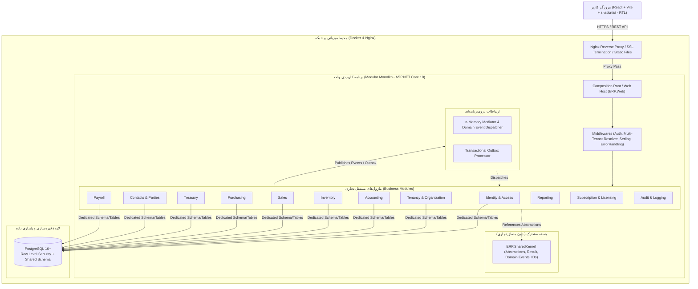
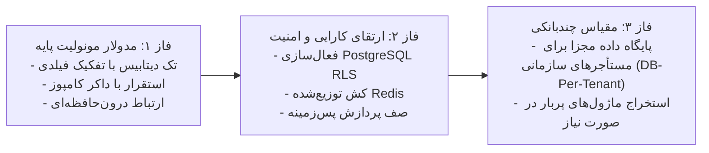

# سند معماری سیستم: بررسی اجمالی معماری (Architecture Overview)

## ۱. معرفی و هدف سیستم

پروژه **ERP** یک سیستم جامع مدیریت منابع سازمانی (Enterprise Resource Planning) با تمرکز بر مدیریت مالی، بازرگانی، انبارداری و منابع انسانی برای شرکت‌های چندشعبه‌ای و هلدینگ‌ها در قالب یک سرویس ابری چندمشتریه (Multi-Tenant SaaS) است.

هدف از این سند، ترسیم خطوط راهنما، اصول مهندسی نرم‌افزار، ساختار کلان و تصمیمات پایه‌ای معماری سیستم است تا تضمین شود نرم‌افزار ضمن حفظ حداکثر سادگی در استقرار و نگهداری، دارای بیشترین قابلیت اطمینان، امنیت داده، آزمون‌پذیری و انعطاف در توسعه تیمی باشد.

---

## ۲. مشخصات قطعی و اصول راهبردی

| شاخص | مقدار مصوب |
| :--- | :--- |
| **نام محصول** | ERP |
| **نوع معماری** | مدولار مونولیت (Modular Monolith) |
| **مدل ارائه‌دهی** | نرم‌افزار به عنوان خدمت (Multi-Tenant SaaS) |
| **بک‌اند** | .NET 10 / C# 14 / ASP.NET Core 10 |
| **فرانت‌اند** | React 19 / TypeScript / Vite / Tailwind CSS / shadcn/ui |
| **پایگاه داده** | PostgreSQL 16+ به همراه Npgsql و EF Core 10 |
| **جداسازی مستأجرها** | پایگاه داده مشترک با تفکیک منطقی و حفاظتی (Shared Database + Shared Schema) با آمادگی برای Database-Per-Tenant |
| **جهت و زبان UI** | زبان فارسی، کاملاً راست‌به‌چپ (RTL)، تقویم شمسی (Jalali) |
| **استاندارد داده در Backend** | زمان‌ها کاملاً استاندارد بر پایه UTC و اعداد مالی به صورت با دقت بالا (High Precision Decimal) |

---

## ۳. الگوی معماری: مدولار مونولیت (Modular Monolith)

### ۳.۱. چرا مدولار مونولیت و نه مایکروسرویس؟
در پروژه‌های ERP سازمانی، به‌ویژه در بخش‌های مالی، انبار و فروش، **یکپارچگی تراکنشی (Transactional Consistency)** و صحت روابط داده‌ای اولویت مطلق دارند. معماری مایکروسرویس (Microservices) چالش‌های سنگینی مانند تراکنش‌های توزیع‌شده (2PC / Sagas)، تأخیر شبکه (Network Latency)، پیچیدگی شکست و مانیتورینگ توزیع‌شده، و هزینه سرسام‌آور DevOps و زیرساخت را تحمیل می‌کند.

در مقابل، **Modular Monolith**:
1. **استقرار یکپارچه (Single Deployment Unit):** هزینه عملیاتی نگهداری و استقرار پایین است (یک کانتینر Web API + کانتینر Frontend + پایگاه داده PostgreSQL).
2. **مرزهای شفاف ماژولار (Strict Module Boundaries):** هر دامنه تجاری (Accounting، Inventory، Sales و ...) مانند یک مینی‌اپلیکیشن با پایگاه داده منطقی، قوانین اعتبارسنجی و لایه‌بندی اختصاصی خود عمل می‌کند.
3. **تراکنش‌های محلی ACID:** در داخل مرزهای معین می‌توان از تراکنش‌های دیتابیس استفاده کرد بدون نیاز به سازگاری نهایی پیچیده در تراکنش‌های حساس مالی.
4. **قابلیت تفکیک آتی (Extractable):** اگر در آینده ماژولی (مانند Reporting یا Inventory) نیاز به مقیاس‌پذیری مستقل پیدا کند، به دلیل عدم وابستگی مستقیم و ارتباط بر پایه قراردادها (Contracts)، با کمترین تغییر به یک میکروسرویس مجزا تبدیل خواهد شد.

### ۳.۲. نمودار کلان سیستم (High-Level Architecture)

---

## ۴. ویژگی‌های کیفی معماری (Quality Attributes)

### ۴.۱. امنیت و ایزولاسیون اطلاعات (Security & Isolation)
- ایزولاسیون کامل سطح مستأجر (Tenant) و شرکت (Company) با روش **Defense in Depth**:
  1. فیلترهای سراسری در سطح ORM (`EF Core Global Query Filters`).
  2. محافظت قطعی در سطح پایگاه داده با `PostgreSQL Row Level Security (RLS)`.
- احراز هویت توکن‌محور بدون وضعیت (Stateless JWT) به همراه اعتبارسنجی مداوم کوکی Refresh Token.
- تفکیک نقش‌ها و دسترسی‌های ریزدانه‌ای (Fine-Grained Permissions) به ازای هر شرکت.

### ۴.۲. آزمون‌پذیری (Testability)
- تفکیک کامل منطق دامنه (Domain) از زیرساخت (Infrastructure).
- قابلیت اجرای تست‌های واحد (Unit Tests) برای صد درصد منطق‌های مالی و کسب‌وکار بدون نیاز به دیتابیس.
- قابلیت اجرای تست‌های یکپارچگی (Integration Tests) بر روی کانتینر واقعی پایگاه داده با استفاده از `Testcontainers`.
- اجرای خودکار تست‌های قوانین معماری (`Architecture Tests` با NetArchTest) در خط CI/CD جهت جلوگیری از نقض مرزهای ماژول‌ها.

### ۴.۳. قابلیت نگهداری و مقیاس‌پذیری (Maintainability & Scalability)
- عدم ایجاد کلاس‌های بزرگ نامتقارن (God Objects) و جلوگیری از تجمع منطق تجاری در لایه‌های اشتراکی (`ERP.SharedKernel`).
- استقرار به کمک Docker Compose و پشتیبانی از ابزارهای مانیتورینگ متمرکز (Structured Logging با Serilog).
- پشتیبانی از سیستم صف تراکنشی داخلی (Transactional Outbox) جهت آماده‌سازی سیستم برای رویدادهای ناهمگام و پردازش‌های پس‌زمینه.

---

## ۵. نقشه راه تکاملی معماری

این سند اساس تمام تصمیمات فنی و مهندسی بعدی سیستم ERP را تشکیل می‌دهد و هرگونه تغییر در آن نیازمند ثبت سند تصمیم معماری (ADR) خواهد بود.
