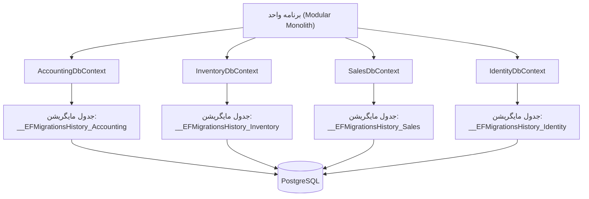

# راهبرد پایگاه داده و مدیریت داده‌ها (Database Strategy & Data Management)

این سند استانداردهای فنی پایگاه داده PostgreSQL، پیکربندی Entity Framework Core 10، تفکیک مایگریشن‌ها، الگوهای نام‌گذاری، بهینه‌سازی و امنیت داده‌ها را مشخص می‌کند.

---

## ۱. پایگاه داده و قواعد نام‌گذاری (Naming Conventions)

### قواعد قرارداد نام‌گذاری:
- **در کدهای C# / .NET:** اسامی کلاس‌ها، پراپرتی‌ها و انتیتی‌ها به صورت `PascalCase` نوشته می‌شوند.
- **در پایگاه داده PostgreSQL:** تمامی اسامی جداول، ستون‌ها، ایندکس‌ها و توابع به صورت یکپارچه با حروف کوچک و خط زیرین (`snake_case`) ذخیره می‌شوند تا از خطاهای حساسیت به حروف (Case Sensitivity) در لینوکس و Postgres جلوگیری شود.
- **پیشوند جداول به تفکیک ماژول (Table Prefixes):** برای سازماندهی منظم جداول در یک اسکیمای واحد و جلوگیری از تداخل اسامی، هر جدول با یک پیشوند سه یا چهار حرفی متعلق به ماژول خود نام‌گذاری می‌شود:

| ماژول | پیشوند جدول | نمونه جدول |
| :--- | :--- | :--- |
| Identity & Access | `sec_` | `sec_users`, `sec_roles`, `sec_permissions` |
| Tenancy & Organization | `org_` | `org_tenants`, `org_companies`, `org_branches`, `org_warehouses` |
| Accounting | `acc_` | `acc_accounts`, `acc_fiscal_years`, `acc_journal_vouchers`, `acc_voucher_lines` |
| Treasury | `trs_` | `trs_bank_accounts`, `trs_cash_boxes`, `trs_cheques`, `trs_receipts` |
| Inventory | `inv_` | `inv_items`, `inv_stock_balances`, `inv_goods_receipts` |
| Purchasing | `pur_` | `pur_purchase_orders`, `pur_purchase_invoices` |
| Sales | `sal_` | `sal_quotations`, `sal_sales_orders`, `sal_sales_invoices` |
| Contacts & Parties | `par_` | `par_parties`, `par_addresses`, `par_bank_infos` |
| Payroll | `pay_` | `pay_employees`, `pay_salary_contracts`, `pay_payslips` |
| Reporting | `rep_` | `rep_report_definitions`, `rep_saved_queries` |
| Subscription | `sub_` | `sub_plans`, `sub_tenant_subscriptions`, `sub_usage_metrics` |
| Audit & Logging | `aud_` | `aud_audit_logs`, `aud_entity_changes` |

---

## ۲. تفکیک DbContextها و مایگریشن‌های مستقل (Isolated DbContexts)

هر ماژول دارای `DbContext` کاملاً مستقل خود است. اشتراک‌گذاری یک DbContext غول‌پیکر (God DbContext) برای کل سیستم اکیداً ممنوع است.



### تنظیم تفکیک مایگریشن در هر ماژول:
برای اینکه تیم‌ها بدون تداخل در مایگریشن‌های یکدیگر بتوانند اسکیما را ارتقا دهند، جدول تاریخچه مایگریشن هر DbContext به صورت اختصاصی تنظیم می‌گردد:

```csharp
services.AddDbContext<AccountingDbContext>(options =>
    options.UseNpgsql(connectionString, npgsqlOptions =>
    {
        npgsqlOptions.MigrationsHistoryTable("__EFMigrationsHistory_Accounting");
    })
    .UseSnakeCaseNamingConvention());
```

---

## ۳. انواع داده‌ای استاندارد و حساس (Data Types)

### ۳.۱. مقادیر پولی و مالی (Strict Decimal Precision)
- **ممنوعیت مطلق انواع اعشاری تقریبی:** استفاده از انواع داده `float` یا `double` در محاسبات مالی، مقادیر قیمت، تعداد موجودی کالا و فاکتورها **اکیداً ممنوع** است.
- در C# از نوع داده `decimal` استفاده می‌شود.
- در PostgreSQL از نوع ستون `numeric(28, 4)` یا `numeric(18, 4)` استفاده خواهد شد. دقت ۴ رقم اعشار برای نگهداری مقادیر ریالی/ارزی دقیق و بهای تمام‌شده واحد کالا الزامی است.

### ۳.۲. کلیدهای اصلی (Primary Keys)
- از شناسه‌های نامتمرکز و ایمن **UUID (نسخه 7 یا متوالی)** به عنوان کلید اصلی انتیتی‌ها استفاده می‌شود تا:
  1. ترتیب درج بر اساس زمان حفظ شده و ایندکس‌های B-Tree دچار پارگی شدید صفحات (Page Fragmentation) نشوند.
  2. شناسه‌ها برای مهاجمان غیرقابل‌حدس زدن باشند (جلوگیری از حملات IDOR).
  3. تولید شناسه در سمت کلاینت یا اپلیکیشن قبل از ذخیره در دیتابیس امکان‌پذیر باشد.

### ۳.۳. زمان و تاریخ (Timestamps)
- تمام ستون‌های تاریخ و زمان در پایگاه داده از نوع `timestamptz` (`timestamp with time zone`) هستند.

---

## ۴. کنترل همروندی و تراکنش‌ها (Concurrency & Transactions)

### ۴.۱. همروندی خوش‌بینانه (Optimistic Concurrency Control)
برای جلوگیری از بازنویسی تصادفی داده‌ها توسط چند کاربر همزمان (Lost Updates):
- در انتیتی‌های حساس (موجودی انبار، سرفصل حساب، فاکتورها) از قابلیت ستون سیستمی `xmin` در PostgreSQL استفاده می‌شود:
  ```csharp
  builder.Entity<JournalVoucher>()
         .Property<uint>("xmin")
         .HasColumnType("xid")
         .ValueGeneratedOnAddOrUpdate()
         .IsConcurrencyToken();
  ```
- در صورت بروز تعارض همروندی، خطای `DbUpdateConcurrencyException` صادر شده و به کاربر پیام خطای مناسب برای بارگذاری مجدد فرم داده می‌شود.

### ۴.۲. پترن Transactional Outbox (جلوگیری از توزیع‌شدگی ناسازگار)
هنگامی که یک عملیات در یک ماژول باید موجب تغییر در ماژول دیگر شود (مثلاً تایید فاکتور فروش که باید در انبار کسر موجودی و در حسابداری سند بزند):
- هرگز از تراکنش‌های توزیع‌شده (2PC / Distributed Transactions) استفاده نمی‌شود.
- رویداد در جدول `aud_outbox_messages` در **همان تراکنش ماژول مبدا** ذخیره می‌شود (Atomic Commit).
- یک فرآیند پس‌زمینه (Background Processor) رویداد را خوانده و با تضمین حداقل یک بار تحویل (At-Least-Once Delivery) به ماژول‌های مقصد دیسپچ می‌کند.
- تمام مصرف‌کنندگان پیام باید بر اساس شناسه پیام (EventId) دارای رفتار **Idempotent** باشند.

---

## ۵. استراتژی ایندکس‌گذاری و کارایی (Indexing Strategy)

1. **ایندکس‌های ترکیبی چندمستأجری:** از آنجا که کلیه کوئری‌ها فیلتر `tenant_id` و `company_id` دارند، تمام ایندکس‌های اصلی به صورت ترکیبی شروع می‌شوند:
   ```sql
   CREATE INDEX idx_acc_vouchers_lookup 
   ON acc_journal_vouchers (tenant_id, company_id, voucher_date, voucher_number);
   ```
2. **ایندکس‌های فیلترشده (Partial Indexes):** برای جداول بزرگ که فیلد حذف منطقی (`is_deleted`) دارند:
   ```sql
   CREATE INDEX idx_inv_items_active 
   ON inv_items (tenant_id, company_id, item_code) 
   WHERE is_deleted = false;
   ```
3. **آمادگی برای پارتیشن‌بندی (Table Partitioning):** جداول بسیار حجیم سیستم (نظیر ریز سطرهای اسناد `acc_voucher_lines` و ریز تراکنش‌های کالا `inv_stock_ledger`) به صورت پارتیشن‌بندی بازه‌ای بر اساس ستون سال مالی (`fiscal_year_id`) یا تاریخ (`voucher_date`) آماده‌سازی می‌شوند.
