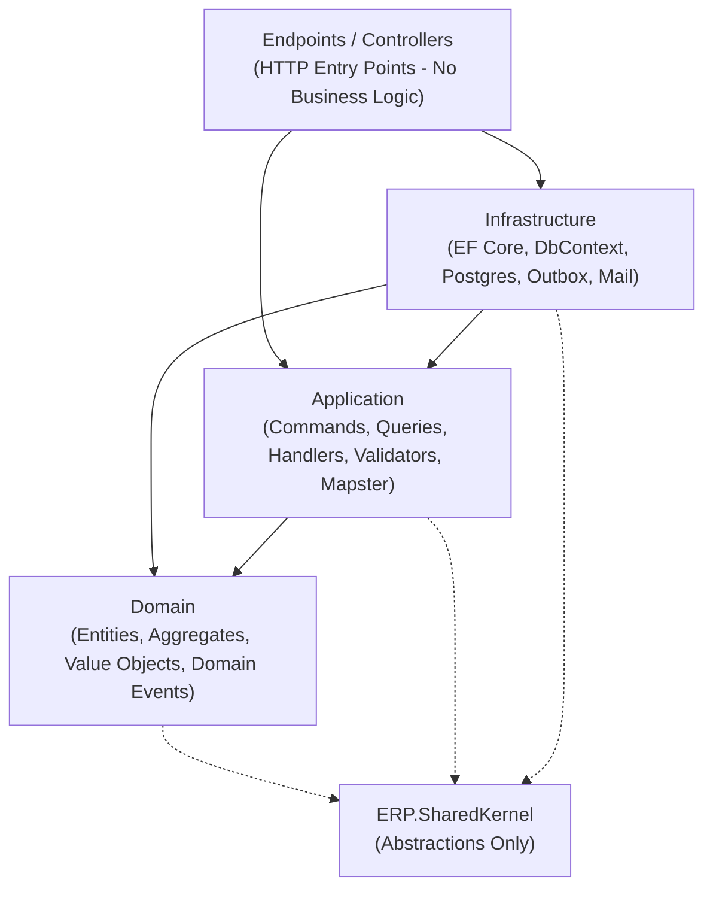
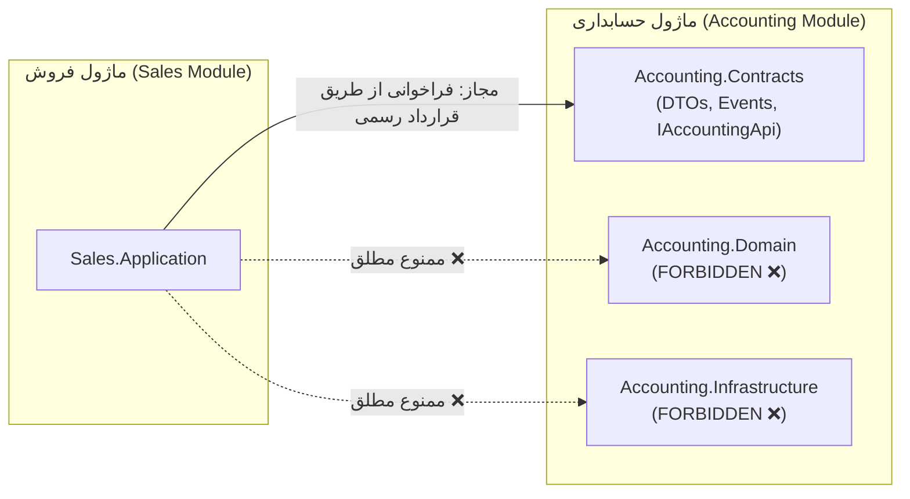

# قوانین وابستگی و سلامت معماری (Dependency Rules & Architecture Integrity)

این سند قوانین سخت‌گیرانه وابستگی میان لایه‌ها و ماژول‌ها، اصول حاکم بر `ERP.SharedKernel` و مکانیزم‌های خودکار اعتبارسنجی معماری را تشریح می‌کند.

---

## ۱. اصل جهت وابستگی در لایه‌های داخلی (Clean Architecture)

هر ماژول به صورت مستقل از اصول Clean Architecture پیروی می‌کند. قانون طلایی این است:
**وابستگی‌ها همواره از لایه‌های بیرونی به سمت لایه‌های درونی است؛ لایه مرکزی (Domain) از وجود هیچ لایه بیرونی مطلع نیست.**

### ۱.۱. قوانین اختصاصی لایه Domain
- **صفر بودن وابستگی خارجی:** پروژه `*.Domain` نباید به هیچ فریم‌ورک زیرساختی نظیر `Microsoft.AspNetCore.*`، `Microsoft.EntityFrameworkCore.*` یا ابزارهای مپینگ وابستگی داشته باشد.
- تنها وابستگی مجاز، پروژه `ERP.SharedKernel` برای استفاده از ابسترکشن‌های پایه‌ای (`Entity<TId>`, `Result`, `IDomainEvent`) است.
- موجودیت‌ها (Entities) باید دارای کپسوله‌سازی کامل (Encapsulation) باشند؛ فیلدهای حساس با متدهای معنادار دامنه تغییر می‌یابند، نه Setterهای عمومی (`public set`).

### ۱.۲. قوانین اختصاصی لایه Application
- هماهنگ‌کننده منطق تجاری سیستم از طریق الگوهای Command و Query.
- هیچ کدی برای اتصال مستقیم به دیتابیس یا اجرای کوئری SQL در این لایه نوشته نمی‌شود؛ دسترسی به داده‌ها از طریق اینترفیس‌های Repository یا Unit of Work تعریف‌شده در همین لایه صورت می‌گیرد.
- اعتبارسنجی ورودی‌ها با FluentValidation در لایه Application انجام می‌شود.

### ۱.۳. قوانین اختصاصی لایه Infrastructure
- پیاده‌سازی اینترفیس‌های تعریف‌شده در Application و Domain (شامل DbContext، اینترسپتورها، ارسال ایمیل، ذخیره‌سازی فایل).
- نگاشت مدل‌های دیتابیس با Fluent API صورت می‌گیرد تا انتیتی‌های Domain آلوده به ویژگی‌های EF Core (مانند Data Annotations) نشوند.

### ۱.۴. قوانین اختصاصی لایه Endpoints / Controllers
- وظیفه این لایه صرفاً دریافت درخواست HTTP، تبدیل آن به Command یا Query، ارسال به Handler مربوطه و بازگرداندن پاسخ HTTP با کد وضعیت متناظر است.
- **ممنوعیت مطلق منطق تجاری در Controller:** هیچ شرط تجاری، محاسبه مالی، یا فراخوانی مستقیم متدهای دیتابیس در کنترلرها مجاز نیست.

---

## ۲. قوانین ارتباط بین ماژول‌ها (Cross-Module Rules)

برای جلوگیری از تبدیل سیستم به یک "کلاف سردرگم" (Big Ball of Mud)، مرزهای بین ماژول‌ها با قوانین زیر مهر و موم می‌شوند:

1. **دسترسی صرفاً از طریق Contracts:** ماژول `A` تنها و تنها می‌تواند به پروژه `Contracts` ماژول `B` رفرنس بدهد.
2. **عدم رفرنس به Domain/Infrastructure دیگران:** ماژول `A` تحت هیچ شرایطی نباید به پروژه‌های `Domain`، `Application`، `Infrastructure` یا `Endpoints` ماژول `B` رفرنس مستقیم داشته باشد.
3. **عدم وابستگی دوری (No Circular Dependencies):** وابستگی دوطرفه بین ماژول‌ها اکیداً ممنوع است (اگر ماژول الف به قراردادهای ماژول ب وابسته است، ماژول ب نباید به قراردادهای ماژول الف وابسته باشد؛ ارتباط بازگشتی باید از طریق رویدادهای ناهمگام انجام شود).

---

## ۳. سیاست حاکم بر `ERP.SharedKernel` (جلوگیری از انباشتگی)

پروژه `ERP.SharedKernel` باید سبک و بدون تغییرات مکرر باقی بماند.

### موارد مجاز در SharedKernel:
- تعاریف اولیه و جنریک: `Entity<TId>`، `AggregateRoot<TId>`، `ValueObject`.
- ساختار الگوی نتیجه: `Result`، `Result<T>`، `Error`، `ErrorType`.
- مارکرهای چندمستأجری: `ITenantScoped`، `ICompanyScoped`، `IBranchScoped`.
- اینترفیس‌های مشترک رویداد: `IDomainEvent`، `IIntegrationEvent`، `IEventDispatcher`.
- اینترفیس تاریخ و زمان: `IDateTimeProvider`.

### موارد اکیداً ممنوع در SharedKernel:
- ❌ انتیتی‌های تجاری (مانند `User`، `Invoice`، `Account`، `Product`).
- ❌ منطق‌های محاسباتی کسب‌وکار (مانند محاسبه مالیات، ارزش افزوده، تخفیف یا استهلاک).
- ❌ اعتبارسنجی‌های وابسته به قوانین بازار یا کسب‌وکار.
- ❌ وابستگی به ابزارهای زیرساختی یا وب.

---

## ۴. اعتبارسنجی خودکار قوانین با آزمون‌های معماری (Architecture Tests)

برای تضمین پایبندی دائمی اعضای تیم به این قوانین، پروژه‌ای تحت عنوان `ERP.ArchitectureTests` ایجاد می‌شود که با اجرای تست‌های NetArchTest در هر Commit و در خط CI/CD از نقض قوانین ممانعت می‌کند:

### نمونه قوانینی که در تست‌ها چک می‌شوند:
1. **قانون ۱:** لایه Domain هیچ پروژه‌ای نباید به سایر لایه‌ها یا پکیج‌های زیرساختی ارجاع داشته باشد.
2. **قانون ۲:** پروژه‌های ماژول‌ها فقط به `Contracts` سایر ماژول‌ها دسترسی دارند و دسترسی به `Domain` و `Infrastructure` یکدیگر شکست تست تلقی می‌شود.
3. **قانون ۳:** در Controllerها نباید به `DbContext` دسترسی مستقیم وجود داشته باشد.
4. **قانون ۴:** انتیتی‌های با اینترفیس `IAggregateRoot` نباید دارای متدهای Setter عمومی برای فیلدهای خود باشند.

> [!IMPORTANT]
> در صورت نقض هر یک از این قوانین توسط کدهای ارسالی توسعه‌دهندگان، بیلد پروژه در خط CI/CD متوقف خواهد شد و مرج پول‌ریکوئست مسدود می‌گردد.
