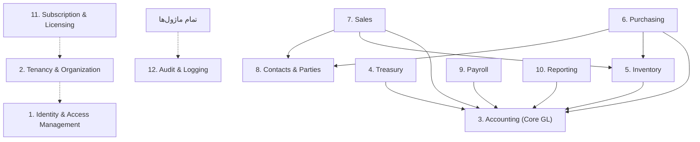

# مرزهای ماژول‌ها و ماتریس ارتباطات (Module Boundaries & Interaction Matrix)

این سند مرزهای تجاری، دامنه مسئولیت‌ها، داده‌های اختصاصی و نحوه تعامل دوازده ماژول اصلی سیستم ERP را مشخص می‌کند.

---

## ۱. فهرست و دامنه مسئولیت ماژول‌های دوازده‌گانه

---

### ۱. ماژول Identity & Access Management (IAM)
- **مسئولیت اصلی:** مدیریت کاربران، احراز هویت (Authentication)، نشست‌های کاری (Sessions)، توکن‌های JWT و هشینگ کلمات عبور.
- **مفاهیم دامنه:** کاربر (`User`)، نقش (`Role`)، مجوز (`Permission`)، ادعاها (`Claims`)، توکن‌های رفرش (`RefreshToken`).
- **خروجی به سایرین (Contracts):** رویدادهای ایجاد/تغییر کاربر، سرویس اعتبارسنجی توکن و اطلاعات پروفایل کاربر (`IIdentityModuleApi`).

### ۲. ماژول Tenancy & Organization
- **مسئولیت اصلی:** مدیریت سطوح ساختار سازمانی چندمشتریه (Tenant -> Company -> Branch -> Warehouse) و عضویت‌های کاربران در هر سطح.
- **مفاهیم دامنه:** مستأجر (`Tenant`)، شرکت (`Company`)، شعبه (`Branch`)، انبار فیزیکی (`Warehouse`)، عضویت (`Membership`).
- **خروجی به سایرین (Contracts):** استخراج دسترسی‌های سازمان کاربر، تعیین فعال بودن شرکت، اعتبارسنجی محدوده‌های سازمان.

### ۳. ماژول Accounting (حسابداری مالی)
- **مسئولیت اصلی:** دفتر کل (General Ledger)، درخت حساب‌ها (Chart of Accounts)، اسناد حسابداری (Journal Entries / Vouchers)، بستن حساب‌ها و دوره‌های مالی.
- **مفاهیم دامنه:** سرفصل حساب (`Account`)، سال مالی (`FiscalYear`)، دوره مالی (`FinancialPeriod`)، سند حسابداری (`JournalVoucher`)، ردیف سند (`VoucherLine`).
- **خروجی به سایرین (Contracts):** اینترفیس ثبت سند حسابداری ناشی از رویدادهای مالی (`IAccountingModuleApi.RegisterVoucherDraftAsync`)، وضعیت دوره مالی.

### ۴. ماژول Treasury (خزانه‌داری)
- **مسئولیت اصلی:** مدیریت وجوه نقد، حساب‌های بانکی، کارت‌خوان‌ها، دریافت و پرداخت، اسناد تجاری دریافتنی/پرداختنی (چک‌ها و سفته‌ها) و مغایرت بانکی.
- **مفاهیم دامنه:** حساب بانکی (`BankAccount`)، صندوق (`CashBox`)، رسید دریافت (`ReceiptVoucher`)، دستور پرداخت (`PaymentVoucher`)، چک دریافتنی/پرداختنی (`Cheque`).
- **خروجی به سایرین (Contracts):** ثبت دریافت و پرداخت فاکتورهای فروش و خرید، اعلام وصول چک به حسابداری.

### ۵. ماژول Inventory (انبار و کالا)
- **مسئولیت اصلی:** تعریف کالاها و خدمات، واحدهای سنجش، رسید انبار، حواله انبار، انتقالات بین‌انباری و محاسبه بهای موجودی.
- **مفاهیم دامنه:** کالا/خدمت (`Item`)، دسته‌بندی (`Category`)، واحد سنجش (`UnitOfMeasure`)، رسید انبار (`GoodsReceipt`)، حواله انبار (`GoodsIssue`)، گردش کالا (`StockLedger`).
- **خروجی به سایرین (Contracts):** استعلام موجودی کالا برای فروش، تایید تحویل کالا به حسابداری صنعتی و بهای تمام‌شده.

### ۶. ماژول Purchasing (خرید و تدارکات)
- **مسئولیت اصلی:** مدیریت درخواست خرید، سفارش خرید به تامین‌کنندگان، دریافت کالا و ثبت فاکتورهای خرید رسمی و غیررسمی.
- **مفاهیم دامنه:** سفارش خرید (`PurchaseOrder`)، فاکتور خرید (`PurchaseInvoice`)، اعلام بدهی به تامین‌کننده.
- **خروجی به سایرین (Contracts):** ثبت سند مالی خرید، افزایش موجودی انبار.

### ۷. ماژول Sales (فروش و بازرگانی)
- **مسئولیت اصلی:** مدیریت پیش‌فاکتور، سفارش فروش، صدور فاکتور فروش رسمی، برگشت از فروش و تخفیفات.
- **مفاهیم دامنه:** پیش‌فاکتور (`Quotation`)، سفارش فروش (`SalesOrder`)، فاکتور فروش (`SalesInvoice`)، مرجوعی فروش (`SalesReturn`).
- **خروجی به سایرین (Contracts):** رزرو موجودی انبار، درخواست صدور سند بستانکاری و درآمد به حسابداری، ایجاد سند دریافتنی به خزانه‌داری.

### ۸. ماژول Contacts & Parties (اشخاص و طرف‌حساب‌ها)
- **مسئولیت اصلی:** پایگاه داده متمرکز اشخاص حقیقی و حقوقی شامل مشتریان، تامین‌کنندگان، پرسنل، واسطه‌ها و شرکا.
- **مفاهیم دامنه:** طرف‌حساب (`Party`)، شخص حقیقی (`Individual`)، شخص حقوقی (`Organization`)، آدرس‌ها، اطلاعات مالیاتی و اعتبارسنجی شناسه ملی.
- **خروجی به سایرین (Contracts):** استعلام اطلاعات شناسنامه‌ای، کد اقتصادی و اطلاعات تماس برای فروش، خرید و خزانه‌داری.

### ۹. ماژول Payroll (حقوق و دستمزد)
- **مسئولیت اصلی:** اطلاعات استخدامی پرسنل، احکام کارگزینی، ساختار حقوقی (پایه‌حقوق، حق مسکن، بن، اضافه‌کار)، محاسبات ماهانه فیش حقوقی و کسورات قانونی (بیمه و مالیات).
- **مفاهیم دامنه:** پرسنل (`Employee`)، حکم حقوقی (`SalaryContract`)، فیش حقوقی ماهانه (`Payslip`)، لیست بیمه و مالیات.
- **خروجی به سایرین (Contracts):** صدور سند هزینه حقوق و دستمزد و ثبت بدهی به سازمان بیمه/مالیات در حسابداری.

### ۱۰. ماژول Reporting (گزارش‌گیری و هوش مالی)
- **مسئولیت اصلی:** تولید ترازهای آزمایشی (۴، ۶ و ۸ ستونی)، صورت سود و زیان، ترازنامه، گزارش‌های تحلیلی سود ناخالص و صادرات خروجی‌های استاندارد اکسل و PDF.
- **مفاهیم دامنه:** تعاریف ساختار ترازنامه (`FinancialReportDefinition`)، قالب‌های چاپ (`PrintTemplate`).
- **خروجی به سایرین (Contracts):** این ماژول صرفاً مصرف‌کننده (Consumer) است و موتور گزارشات را به کاربران ارائه می‌دهد.

### ۱۱. ماژول Subscription & Licensing (اشتراک و مجوزها)
- **مسئولیت اصلی:** مدیریت پلن‌های اشتراک مشتریان، کنترل سقف‌های منابع (تعداد کاربر، تعداد شرکت، حجم فضا)، تاریخ انقضا و کلیدهای فعال‌سازی قابلیت‌ها.
- **مفاهیم دامنه:** پلن اشتراک (`SubscriptionPlan`)، سهمیه مصرفی (`TenantQuota`)، لایسنس فعال (`ActiveLicense`).
- **خروجی به سایرین (Contracts):** میدل‌ویر بررسی سهمیه و فعال بودن فیچرها (`IFeatureChecker`).

### ۱۲. ماژول Audit & Activity Logging (لاگ و تاریخچه)
- **مسئولیت اصلی:** ثبت تغییرات داده‌ای (چه کسی، در چه تاریخی، چه مقداری را از چه به چه تغییر داد)، وقایع امنیتی و لاگ دسترسی کاربران به صورت تغییرناپذیر.
- **مفاهیم دامنه:** رکورد حسابرسی (`AuditLog`)، واقعه امنیتی (`SecurityEvent`).
- **خروجی به سایرین (Contracts):** اینترسپتور ثبت خودکار تغییرات در تمام ماژول‌ها.

---

## ۲. قوانین ایزولاسیون داده‌ها و روابط بین ماژول‌ها

برای حفظ سلامت مرزهای مدولار، این قوانین غیرقابل‌نقض هستند:

### ۲.۱. ممنوعیت Foreign Key فیزیکی بین جداول ماژول‌های مختلف
- **قانون:** در سطح دیتابیس، هیچ قید کلید خارجی (Foreign Key Constraint) نباید بین جدول یک ماژول با جدول ماژول دیگر تعریف شود.
- **مثال:** جدول فاکتور فروش (`sales_invoices`) فیلدی به نام `customer_id` از نوع `uuid` دارد. این فیلد به عنوان یک **Logical Foreign Key** عمل می‌کند، اما در دیتابیس قید `REFERENCES parties(id)` برای آن ایجاد **نمی‌شود**.
- **دلیل:** وجود FK دیتابیسی مانع از دیپلوی مستقل مایگریشن‌ها شده و وابستگی سخت داده‌ای ایجاد می‌کند که شکستن معماری را در آینده ناممکن می‌سازد.

### ۲.۲. ممنوعیت پرس‌وجوی مستقیم (No Cross-DbContext Queries)
- هیچ ماژولی حق ندارد `DbContext` ماژول دیگری را تزریق (Inject) کرده یا مستقیماً به جداول آن کوئری (`JOIN`) بزند.
- تمام تبادل داده‌ها باید از طریق متدهای تعریف‌شده در پروژه `Contracts` آن ماژول صورت گیرد.

---

## ۳. الگوهای ارتباطات بین ماژول‌ها

ارتباط بین ماژول‌ها منحصراً از دو طریق صورت می‌پذیرد:

### ۳.۱. ارتباط همگام (Synchronous Queries / Operations)
- استفاده از اینترفیس‌های موجود در `Contracts` ماژول مقصد.
- این متدها داده‌های سبک (مانند نام طرف‌حساب، وضعیت فعال بودن شرکت یا موجودی انبار) را در قالب DTO بازمی‌گردانند.
- پیاده‌سازی این اینترفیس در لایه `Application` یا `Infrastructure` ماژول مقصد قرار داشته و در DI ثبت می‌شود.

### ۳.۲. ارتباط ناهمگام مبتنی بر رویداد (Event-Driven via Outbox)
- هنگامی که تغییری در یک ماژول نیازمند عکس‌العمل زنجیره‌ای در سایر ماژول‌هاست (مانند: تایید فاکتور فروش که باید سند حسابداری صادر کرده و کالا از انبار کسر شود).
- **مکانیزم اجرا:**
  1. ماژول مبدا رویداد تجاری (`OrderConfirmedIntegrationEvent`) را در همان تراکنش دیتابیس خود در جدول `Outbox` ذخیره می‌کند.
  2. یک پردازشگر پس‌زمینه (Background Worker) این رویداد را خوانده و به صورت درون‌برنامه‌ای (In-Memory Mediator / Event Dispatcher) به شنوندگان (Handlers) در ماژول‌های Accounting و Inventory ارسال می‌کند.
  3. به این ترتیب شکست احتمالی ماژول‌های دیگر، فرآیند اصلی را بدون کنترل از کار نمی‌اندازد و قابلیت تلاش مجدد (Retry) فراهم می‌شود.
