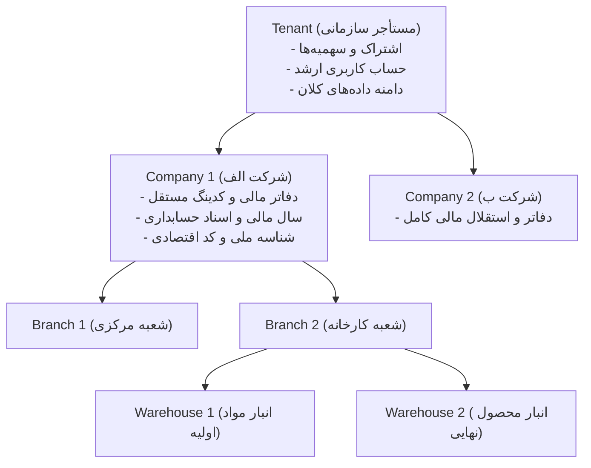
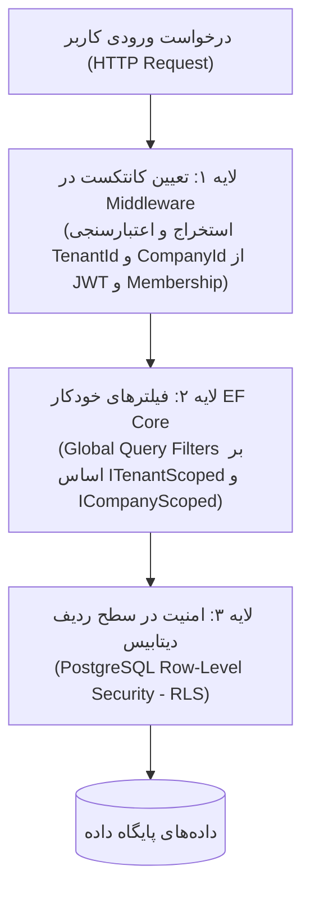

# راهبرد چندمستأجری و ایزولاسیون سازمانی (Multi-Tenancy & Organizational Strategy)

این سند معماری تفکیک داده‌ها، مدل ساختار سازمانی، مکانیزم‌های تفکیک و احراز محدوده دسترسی، و نقشه راه تکامل به Database-per-Tenant را تعریف می‌کند.

---

## ۱. مدل ساختار سازمانی (Organizational Hierarchy)

سیستم ERP از یک ساختار سلسله‌مراتبی چهار سطحی پیروی می‌کند:

```text
Tenant (مستأجر / هلدینگ / مالک حساب اشتراک)
  └── Company (شخص حقوقی مستقل / شرکت دارای دفاتر مالی جداگانه)
        └── Branch (شعبه اداری، فروشگاه، کارخانه یا مرکز فعالیت)
              └── Warehouse (انبار فیزیکی یا مجازی کالاها)
```



### ویژگی‌ها و قوانین طلایی ساختار سازمانی:
1. **استقلال کامل مالی شرکت‌ها (Company-Level Financial Independence):** هر شرکت (`Company`) دارای یک کدینگ حسابداری، سال‌های مالی، دفاتر روزنامه و کل، و صورت‌های مالی کاملاً مجزاست. ادغام داده‌ها فقط در سطح گزارش‌های تلفیقی (Consolidated Reports) تعریف می‌شود.
2. **استقلال مفاهیم شناسه:** شناسه‌های `TenantId`، `CompanyId` و `BranchId` مفاهیم کاملاً مستقل از هم هستند و نباید با یکدیگر ترکیب شوند.
3. **دسترسی چندگانه کاربران:** یک کاربر (با یک ایمیل یا شناسه ملی واحد) می‌تواند در چندین مستأجر یا چندین شرکت عضویت داشته باشد. نقش و دسترسی‌های کاربر به تفکیک هر شرکت ارزیابی می‌شود.

---

## ۲. مدل ذخیره‌سازی داده‌ها: پایگاه داده مشترک با تفکیک ایمن (Shared DB + Shared Schema)

در فاز کنونی، مدل **پایگاه داده مشترک با اسکیمای مشترک (Shared Database + Shared Schema)** به عنوان معماری پایه انتخاب شده است.

### دلایل انتخاب:
- حداقل‌سازی هزینه استقرار، سخت‌افزار و سرور برای ارائه SaaS اقتصادی.
- مدیریت یکپارچه مایگریشن‌ها و به‌روزرسانی اسکیمای تمام مشتریان در یک مرحله.
- سهولت در مانیتورینگ متمرکز، بکاپ‌گیری و مدیریت منابع دیتابیس.

### مخاطره و راهکار رفع آن (Data Leakage Risk):
بزرگترین ریسک این مدل، نشت داده‌ها بین مستأجرها در صورت خطای برنامه‌نویس در فراموش کردن شرط `WHERE tenant_id = ...` است. برای حل بنیادین این مشکل، استراتژی **دفاع در عمق (Defense in Depth)** به کار گرفته می‌شود.

---

## ۳. استراتژی دفاع در عمق برای ایزولاسیون داده‌ها (Defense in Depth)

ایزولاسیون در سه لایه مستقل و مکمل اعمال می‌شود و به هیچ عنوان به فیلترهای ارسالی از سمت کلاینت (فرانت‌اند) اعتماد نمی‌شود:



### ۳.۱. لایه ۱: کانتکست چندمستأجری (Tenant Context Middleware)
- با هر درخواست HTTP، شناسه `TenantId` و `CompanyId` هدف از طریق هدرهای استاندارد (`X-Tenant-Id`, `X-Company-Id`) یا Claims موجود در توکن امن JWT استخراج می‌شود.
- میدل‌ویر کانتکست با بررسی پایگاه داده بررسی می‌کند که آیا کاربر جاری **حق دسترسی فعال** به این شرکت و مستأجر را دارد یا خیر.
- در صورت عدم تطابق یا عدم احراز، درخواست بلافاصله با خطای `403 Forbidden` متوقف می‌شود (Fail Fast).

### ۳.۲. لایه ۲: فیلترهای سراسری EF Core (Global Query Filters)
انتیتی‌های وابسته به سطوح سازمانی، اینترفیس‌های مارکر را پیاده‌سازی می‌کنند:

```csharp
public interface ITenantScoped
{
    Guid TenantId { get; }
}

public interface ICompanyScoped : ITenantScoped
{
    Guid CompanyId { get; }
}

public interface IBranchScoped : ICompanyScoped
{
    Guid BranchId { get; }
}
```

در هنگام بارگذاری مدل‌ها در `DbContext`:
- فیلتر `HasQueryFilter(e => e.TenantId == _currentTenant.TenantId)` به تمام انتیتی‌های مستأجر اعمال می‌شود.
- فیلتر `HasQueryFilter(e => e.CompanyId == _currentCompany.CompanyId)` به صورت خودکار به تمام انتیتی‌های سطح شرکت (اسناد مالی، انبار، فاکتورها) اعمال می‌شود.
- حتی اگر توسعه‌دهنده در کوئری خود شرط TenantId را ننویسد، EF Core به صورت خودکار آن را به کوئری SQL تولیدی الصاق می‌کند.

### ۳.۳. لایه ۳: امنیت سطح ردیف در پایگاه داده (PostgreSQL Row-Level Security)
حتی اگر برنامه‌نویس به اشتباه از دستور `.IgnoreQueryFilters()` در EF Core استفاده کند، پایگاه داده اجازه نقض ایزولاسیون را نخواهد داد.
- روی جداول حساس، قابلیت RLS فعال می‌شود:
  ```sql
  ALTER TABLE acc_journal_vouchers ENABLE ROW LEVEL SECURITY;
  
  CREATE POLICY tenant_company_isolation_policy ON acc_journal_vouchers
  AS RESTRICTIVE
  USING (
      tenant_id = NULLIF(current_setting('app.current_tenant_id', true), '')::uuid
      AND
      company_id = NULLIF(current_setting('app.current_company_id', true), '')::uuid
  );
  ```
- در سطح `DbConnectionInterceptor` در دات‌نت، هنگام باز شدن هر کانکشن به دیتابیس، این پارامترهای سشن محلی ست می‌شوند:
  ```csharp
  // اجرا در سطح تراکنش/سشن محلی قبل از اجرای دستورات
  SET LOCAL app.current_tenant_id = '...';
  SET LOCAL app.current_company_id = '...';
  ```

---

## ۴. چرخه حیات درخواست چندشرکتی (Multi-Company Request Flow)

1. کاربر وارد سامانه شده و لیست شرکت‌های مجاز خود را دریافت می‌کند.
2. با انتخاب یک شرکت، توکن یا هدر فعال با `CompanyId` انتخابی در درخواست‌ها ارسال می‌گردد.
3. تمام عملیات صدور سند، جستجوی کالا و عملیات مالی فقط و فقط در محدوده آن شرکت بازخوانی و ثبت می‌شوند.
4. اگر کاربر بخواهد بین شرکت‌ها جابجا شود، بدون نیاز به ورود مجدد (Logout)، کانتکست کاری تغییر یافته و رابط کاربری به اطلاعات شرکت دوم هدایت می‌گردد.

---

## ۵. نقشه راه مهاجرت به Database Per Tenant (آینده‌نگری)

برای سازمان‌های بزرگی که به دلایل قانونی، حاکمیت داده (Data Sovereignty) یا حجم تراکنش بالا نیازمند پایگاه داده فیزیکی مستقل هستند، معماری به گونه‌ای طراحی شده است که بدون تغییر کد تجاری از آن پشتیبانی کند:

1. **طراحی با اینترفیس `ITenantConnectionResolver`:** سرویس اختصاص کانکشن استرینگ به ازای هر درخواست از طریق یک Resolver انجام می‌شود.
2. **کانکشن‌های پویا:** برای کلاینت‌های معمولی از کانکشن دیتابیس مشترک و برای کلاینت‌های سازمانی خاص از کانکشن دیتابیس مجزا استفاده می‌شود.
3. **عدم وابستگی به نام پایگاه داده:** تمامی کوئری‌ها بر پایه پارامترهای دامنه‌ای نوشته می‌شوند و هیچ نام پایگاه داده‌ای به صورت هاردکد در سیستم وجود ندارد.
