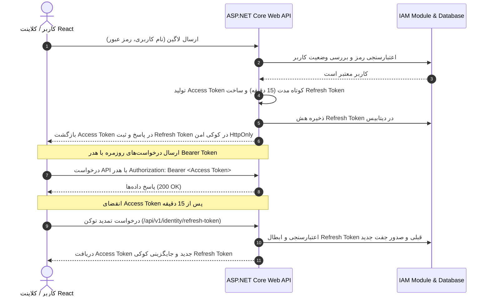
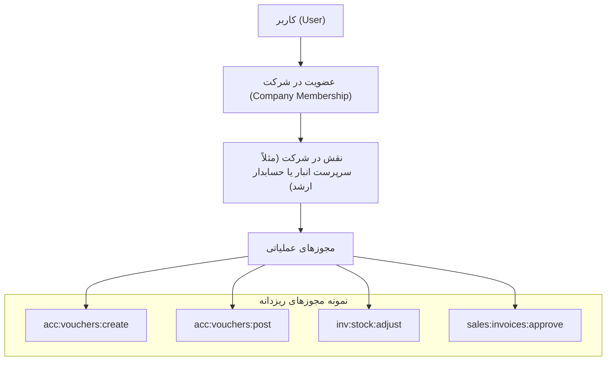

# معماری امنیت و احراز هویت (Security & Authorization Architecture)

این سند استانداردها، پروتکل‌ها و سازوکارهای امنیتی سیستم ERP را در سطوح احراز هویت، کنترل دسترسی، محافظت از API و امنیت پایگاه داده تشریح می‌کند.

---

## ۱. مدل احراز هویت (Authentication Model)

سیستم از ترکیب **ASP.NET Core Identity** برای مدیریت کاربران و کلمات عبور، به همراه **JWT (JSON Web Tokens)** و **Refresh Token جابجا شونده (Rotating Refresh Token)** برای برقراری ارتباط امن و بدون وضعیت استفاده می‌کند.



### ۱.۱. ویژگی‌های توکن امنیتی (JWT Payload)
- **عمر کوتاه (Short-Lived):** عمر مفید Access Token حداکثر ۱۵ دقیقه است تا در صورت سرقت، پنجره زمانی سوءاستفاده بسیار محدود باشد.
- **محتوای ادعاها (Claims):**
  - `sub`: شناسه یکتای کاربر (`UserId`)
  - `email`: آدرس ایمیل کاربر
  - `jti`: شناسه یکتای توکن جهت ابطال سریع
  - `tenant_id`: شناسه پیش‌فرض مستأجر جاری
  - `company_id`: شناسه شرکت جاری انتخابی
  - `permissions`: آرایه‌ای از مجوزهای کاربر در شرکت انتخابی (مانند `acc:vouchers:create`, `inv:items:read`)

### ۱.۲. مدیریت امن Refresh Token
- توکن‌های بازنشانی همواره در کوکی با پرچم‌های `HttpOnly`، `Secure` و `SameSite=Strict` ذخیره می‌شوند تا از حملات XSS در مرورگر محافظت شوند.
- **سیاست جابجایی مداوم (Token Rotation):** به محض استفاده از یک Refresh Token، آن توکن بلافاصله منقضی و باطل شده و یک توکن جدید جایگزین می‌شود.
- **شناسایی سرقت توکن (Reuse Detection):** اگر یک Refresh Token منقضی یا استفاده‌شده مجدداً به سرور ارسال شود، سرور تمام نشست‌های فعال آن کاربر را به عنوان اقدام خرابکارانه فوراً باطل می‌کند.

---

## ۲. مدل کنترل دسترسی و مجوزها (Permission-Based Authorization)

در سیستم‌های ERP سازمانی، سیستم سنتی نقش‌محور (Role-Based) انعطاف کافی ندارد؛ بنابراین سیستم بر پایه **مجوزهای ریزدانه (Granular Permissions)** و **عضویت در شرکت** طراحی شده است.



### ۲.۱. قوانین حاکم بر مجوزها:
1. **فرمت استاندارد رشته مجوز:** `{module}:{resource}:{action}` (نمونه: `accounting:vouchers:create`, `treasury:cheques:sign`).
2. **ارزیابی در سطح شرکت:** یک کاربر ممکن است در «شرکت الف» دسترسی مدیر مالی (`accounting:vouchers:post`) داشته باشد، اما در «شرکت ب» صرفاً مشاهده‌کننده عادی (`accounting:vouchers:read`) باشد. دسترسی‌ها هرگز در سطح سراسری ارزیابی نمی‌شوند مگر برای ادمین کل سیستم.
3. **اعمال در سطح اندپوینت‌ها:** تمام اندپوینت‌های سیستم با اتریبیوت اختصاصی یا فیلترهای مجوز محافظت می‌شوند:
   ```csharp
   [HasPermission("accounting:vouchers:create")]
   [HttpPost("vouchers")]
   public async Task<IActionResult> CreateVoucher(...) { ... }
   ```

---

## ۳. امنیت خط لوله API و لایه‌های شبکه

### ۳.۱. محدودسازی نرخ درخواست (Rate Limiting)
- استفاده از قابلیت بومی Rate Limiting در ASP.NET Core 10 به ازای هر IP و به ازای هر مستأجر:
  - اندپوینت‌های حساس احراز هویت (لاگین، رفرش توکن): حداکثر ۵ درخواست در دقیقه به ازای هر IP جهت جلوگیری از حملات Brute-Force.
  - اندپوینت‌های عمومی کسب‌وکار: حداکثر ۱۰۰۰ درخواست در دقیقه به ازای هر کاربر/شرکت جهت جلوگیری از محروم‌سازی سرویس (DoS).

### ۳.۲. سیاست‌های سخت‌گیرانه CORS
- فرانت‌اند صرفاً از دامنه‌های مجاز و وایت‌لیست‌شده (Whitelisted Origins) حق برقراری ارتباط دارد.
- در محیط پروداکشن ارسال هرگونه `*` (Wildcard) در هدر CORS مسدود است و `AllowCredentials` فقط برای دامنه‌های تاییدشده فعال است.

### ۳.۳. هدرهای امنیتی (Security Headers)
سرور Nginx و میدل‌ویرهای وب موظف به تزریق هدرهای زیر در تمامی پاسخ‌ها هستند:
- `Strict-Transport-Security: max-age=31536000; includeSubDomains` (اجبار دائم HTTPS)
- `X-Content-Type-Options: nosniff` (جلوگیری از MIME Sniffing)
- `X-Frame-Options: DENY` (محافظت کامل در برابر Clickjacking)
- `Content-Security-Policy: default-src 'self'; ...` (کنترل منابع لود شده در مرورگر)
- `Referrer-Policy: strict-origin-when-cross-origin`

### ۳.۴. مصونیت در برابر تزریق کد (SQL Injection Immunity)
- دسترسی به پایگاه داده منحصراً از طریق Entity Framework Core و کوئری‌های پارامتری‌شده Npgsql انجام می‌شود.
- نوشتن کوئری‌های خام متنی چسبانده‌شده (`Raw String Concatenation`) اکیداً ممنوع بوده و توسط آنالیزورهای کدهای استاتیک مسدود می‌شود.

---

## ۴. محافظت از داده‌های حساس و کلیدها

1. **مدیریت رمزها و اسرار (Secrets Management):** هیچ کلمه عبور، کانکشن استرینگ یا کلید خصوصی نباید در فایل‌های کانفیگ (`appsettings.json`) گیت کامیت شود؛ همگی از متغیرهای محیطی سیستم‌عامل یا Docker Secrets تزریق می‌گردند.
2. **رمزنگاری فیلدهای حساس:** اطلاعات حساسی مانند شماره شبای بانکی یا توکن‌های وب‌هوک شخص ثالث به صورت رمزنگاری‌شده در پایگاه داده ذخیره خواهند شد.
3. **لاگ تغییرناپذیر وقایع امنیتی:** هرگونه تلاش ناموفق برای ورود، تغییر رمز عبور، انتساب دسترسی و تغییر شرکت با جزئیات کامل و بدون امکان حذف در سیستم Audit ذخیره می‌گردد.
