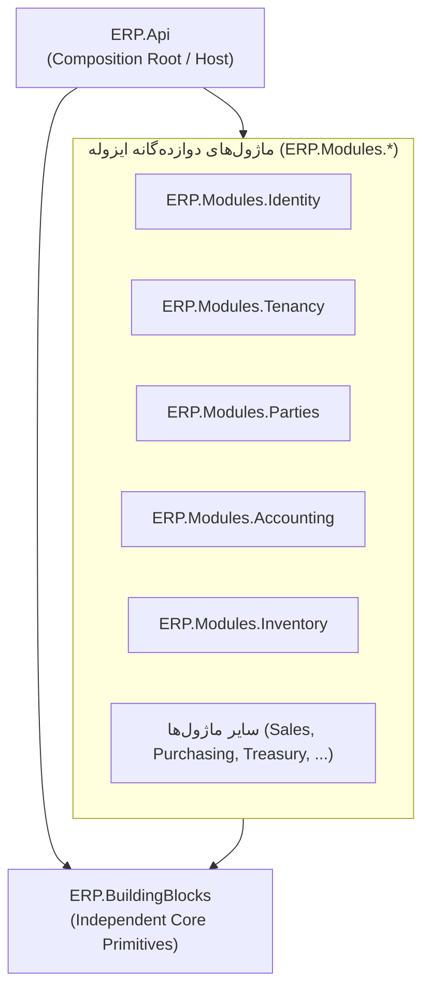

# راهنمای راه‌اندازی و توسعه محیط بک‌اند (Backend Setup & Developer Guide)

این سند راهنمای گام‌به‌گام راه‌اندازی، استانداردهای کامپایل، مدیریت پکیج‌ها و اجرای پروژه‌های بک‌اند سیستم ERP را تشریح می‌کند.

---

## ۱. پیش‌نیازهای نرم‌افزاری

1. **.NET SDK:** نسخه **10.0.401** یا جدیدتر.
2. **PostgreSQL:** نسخه 16 یا 17 (در فازهای پیاده‌سازی دیتابیس با Docker Compose بالا آورده خواهد شد).
3. **IDE:** Visual Studio 2026 / Visual Studio Code / JetBrains Rider با پشتیبانی کامل از C# 14 و .NET 10.

---

## ۲. ساختار پروژه‌ها و قوانین ارجاع (Project Reference Rules)

سیستم ERP یک **Modular Monolith** واقعی است. قوانین وابستگی زیر در سطح Solution تثبیت شده‌اند:



### اصول طلایی وابستگی:
1. **ERP.BuildingBlocks:** فاقد هرگونه وابستگی به پروژه‌های دیگر سیستم است.
2. **ERP.Api:** فقط نقش Composition Root را دارد؛ همه ماژول‌ها را رجیستر کرده و خط لوله Middleware را تنظیم می‌کند.
3. **عدم وابستگی پروژه به پروژه بین ماژول‌ها (Zero Cross-Module Project References):** هیچ ماژولی در فایل `.csproj` خود به ماژول دیگر رفرنس ندارد. ارتباطات بین‌ماژولی صرفاً از طریق رویدادهای عمومی (`IntegrationEvent`) یا اینترفیس‌های مشترک در Composition Root انجام می‌گیرد.
4. **عدم وابستگی دوری (No Circular Dependencies):** با ساختار مستقل ماژول‌ها، احتمال ایجاد چرخه به صفر رسیده است.

---

## ۳. مدیریت متمرکز پکیج‌ها (Central Package Management - CPM)

تمام نسخه‌های پکیج‌های NuGet در فایل `Directory.Packages.props` در ریشه مخزن تعیین می‌شوند.
- در فایل‌های `.csproj` پروژه‌ها، تگ `<PackageReference>` فقط شامل ویژگی `Include` است و هیچ ویژگی `Version` در داخل پروژه‌ها نوشته نمی‌شود.
- برای ارتقای نسخه یک پکیج، تنها فایل `Directory.Packages.props` ویرایش می‌گردد تا تمام پروژه‌ها هماهنگ باقی بمانند.

---

## ۴. استانداردهای کامپایلر (Directory.Build.props)

تنظیمات زیر برای تمام پروژه‌ها به صورت خودکار اعمال می‌گردد:
- `<TargetFramework>net10.0</TargetFramework>`
- `<Nullable>enable</Nullable>`: اجبار بررسی کدهای Nullable.
- `<ImplicitUsings>enable</ImplicitUsings>`: کاهش کدهای Using تکراری.
- `<LangVersion>latest</LangVersion>`: استفاده از تمام قابلیت‌های C# 14.

---

## ۵. دستورات کاربردی خط فرمان (CLI Commands)

```bash
# 1. بازیابی وابستگی‌ها
dotnet restore ERP.sln

# 2. بیلد کامل سولوشن بدون هشدار
dotnet build ERP.sln

# 3. اجرای تمام آزمون‌های واحد، ساختار، امنیت و یکپارچگی
dotnet test ERP.sln --no-build

# 4. اجرای سرور توسعه وب API
dotnet run --project src/ERP.Api
```

---

## ۶. مستندات تعاملی API

پس از اجرای پروژه `ERP.Api`، داکیومنت OpenAPI در مسیر زیر آماده آزمون و بازرسی است:
`https://localhost:5001/swagger`
- هدر احراز هویت: `Authorization: Bearer <token>`
- هدرهای کانتکست مستأجر: `X-Tenant-Id`, `X-Company-Id`, `X-Branch-Id`
