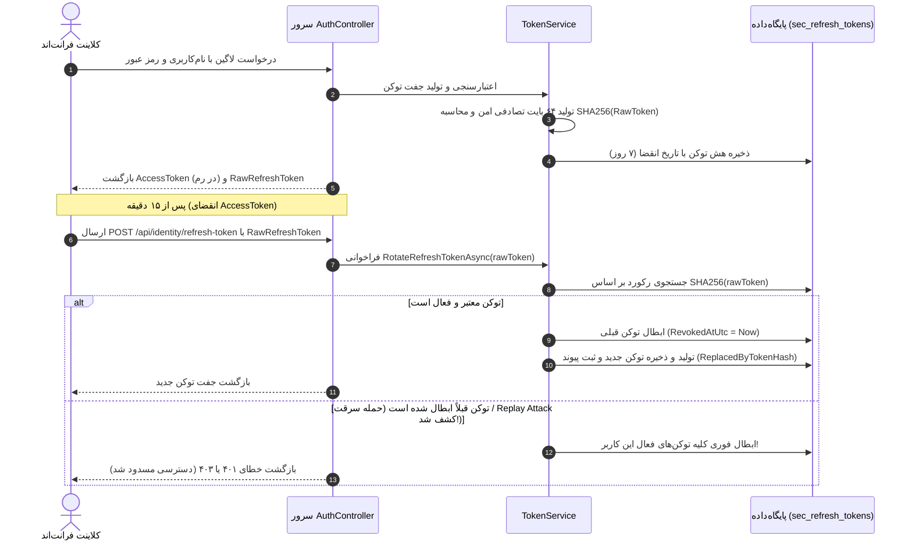

# مستندات احراز هویت و چرخش توکن (Authentication & Token Security)

این سند معماری و مشخصات امنیتی سیستم احراز هویت کاربران، ساختار JWT و استراتژی امنیتی Refresh Token را تشریح می‌کند.

---

## ۱. مشخصات JWT Access Token

- **الگوریتم امضا:** HMAC SHA-256 با کلید متقارن حداقل ۳۲ بایتی.
- **طول عمر توکن:** ۱۵ دقیقه (Short-lived جهت حداقل‌سازی ریسک سرقت توکن).
- **Claimهای استاندارد:**
  - `sub`: شناسه کاربر (`Guid`).
  - `email`: پست الکترونیک کاربر.
  - `jti`: شناسه منحصر‌به‌فرد توکن (UUID v4).
  - `name`: نام کامل کاربر.
  - `tenant_id`: شناسه سازمان فعال در زمان صدور.
  - `company_id`: شناسه شرکت فعال در زمان صدور.
  - `branch_id`: شناسه شعبه فعال (در صورت انتخاب).
  - `role`: نقش‌های انتساب‌یافته.
  - `permission`: دسترسی‌های اعطا شده بر مبنای عضویت در شرکت.

---

## ۲. معماری Refresh Token با چرخش ایمن (Rotation)

سیستم از الگوی پیشرفته و استاندارد OWASP برای مدیریت Refresh Token استفاده می‌کند:

---

## ۳. حفاظت در برابر حملات ذخیره‌سازی
1. **عدم ذخیره توکن خام در دیتابیس:** در جدول `sec_refresh_tokens` صرفاً هش `SHA256` نگهداری می‌شود؛ در نتیجه حتی با سرقت کامل فایل پشتیبان پایگاه‌داده، مهاجم قادر به بازیابی توکن رفرش معتبر نخواهد بود.
2. **عدم ذخیره توکن در LocalStorage فرانت‌اند:** کلاینت فرانت‌اند توکن دسترسی را منحصراً در متغیرهای حافظه مدیریت می‌کند.
